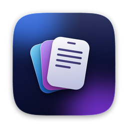

<p align="center">
  
</p>

<h1 align="center">ClipStack</h1>

<p align="center">
  <b>Everything you copy, one shortcut away.</b><br>
  A tiny, native clipboard manager for Mac.
</p>

<p align="center">
  
  
  
  
</p>

<p align="center">
  <a href="https://github.com/vikas-6/ClipStack-pub/releases/latest/download/ClipStack.dmg"><b>⬇️ Download for Mac</b></a>
</p>

---

## What it does

Copy as many times as you like with `⌘C`. Press `⌘⇧V` anywhere and a small panel opens next to your cursor with everything you copied. Click an item to paste it, or drag it straight into Mail, Slack, Finder or a browser upload.

- **Text, images and files.** PDFs get a first-page preview, screenshots a thumbnail, other files their icon, type and size.
- **Search and keyboard.** Type to filter, `↑` `↓` to move, `Return` to paste, `Esc` to close.
- **Native and light.** Written in Swift, not Electron. It checks the clipboard twice a second and builds its panel only when you open it.
- **Private.** No account, no cloud, no analytics. History stays on your Mac, and copies from password managers are never saved.
- **Quiet.** Lives in the menu bar, no Dock icon, optional launch at login.

## Install

1. Download **ClipStack.dmg** from the [latest release](https://github.com/vikas-6/ClipStack-pub/releases/latest) and drag ClipStack to **Applications**.
2. Open it. macOS will say it cannot verify the app, because ClipStack is free and not notarized by Apple. Click **Done**, then open **System Settings, Privacy & Security** and click **Open Anyway**. You only do this once.
3. Prefer Terminal? Run this once instead, then open the app normally:
   ```
   xattr -dr com.apple.quarantine /Applications/ClipStack.app
   ```
4. Optional: choose **Enable Auto-Paste** from the menu bar icon and allow ClipStack under **Privacy & Security, Accessibility**. Without it, ClipStack copies the item and you press `⌘V` yourself.

**Requires** macOS 14 Sonoma or later on a Mac with Apple silicon (M1 or newer).

## Shortcuts

| Action | Keys |
| --- | --- |
| Open history | `⌘⇧V` |
| Move through items | `↑` `↓` |
| Paste selected item | `Return` |
| Close | `Esc` |
| Delete an item | Right-click, Delete |

## Updates

ClipStack checks for a new version about once a day and asks before doing anything: **Download Update**, **Remind Me Later** or **Skip This Version**. You can also choose **Check for Updates…** from the menu bar icon, or turn automatic checks off there.

## Privacy

Your clipboard history is stored only on your Mac, in `~/Library/Application Support/ClipStack`. The app's only network request is the optional daily update check, which downloads one small file (`latest.json`) from this repository and sends no clipboard data. GitHub may see your IP address for that request. Use **Clear History** in the menu to delete everything.

## FAQ

**Does it work on Intel Macs?** Not in this version. It is built for Apple silicon.

**How many items does it keep?** The latest 100.

**Why the security warning?** Apple charges developers a yearly fee to notarize apps. ClipStack is free and independent, so macOS asks you to approve it once.

**Can I change the shortcut?** Not yet. It is `⌘⇧V`.

## Support

Questions or bugs: [projectsbyvikas0@gmail.com](mailto:projectsbyvikas0@gmail.com). If ClipStack saves you time, you can [buy me a coffee](https://buymeacoffee.com/otterbtw_).

---

<p align="center">© 2026 Vikas Kumar. Free to use, all rights reserved.</p>
